# TÀI LIỆU HƯỚNG DẪN LUỒNG DỮ LIỆU & KỊCH BẢN DEMO HỆ THỐNG
## HỖ TRỢ QUẢN LÝ PHIÊN HỌP VÀ THỰC HIỆN NGHỊ QUYẾT HỘI ĐỒNG TRƯỜNG STU
**Đề tài Luận văn tốt nghiệp – Đại học Công nghệ Sài Gòn (STU) – Năm 2026**  
**Giảng viên hướng dẫn:** ThS. Nguyễn Kiều Oanh  
**Sinh viên thực hiện:** Nguyễn Trung Hiếu & Đặng Trọng Danh  

---

## I. TỔNG QUAN CHUỖI LIÊN KẾT DỮ LIỆU CỐT LÕI (CORE DATA FLOW)

Mục tiêu số một của đề tài là giải quyết sự phân tán tài liệu và dữ liệu hành chính của Hội đồng trường bằng một chuỗi liên kết xuyên suốt khép kín:

$$\mathbf{Hồ\ sơ\ trình} \longrightarrow \mathbf{Phiên\ họp} \longrightarrow \mathbf{Biểu\ quyết} \longrightarrow \mathbf{Nghị\ quyết} \longrightarrow \mathbf{Nhiệm\ vụ} \longrightarrow \mathbf{Kết\ quả\ thực\ hiện}$$

### Sơ đồ luân chuyển dữ liệu và trạng thái trong hệ thống:

```mermaid
flowchart TD
    A["1. ĐƠN VỊ TRÌNH HỒ SƠ<br/>(Khoa CNTT / Phòng Đào tạo)<br/>- Nộp tờ trình + Tài liệu (.docx/.pdf)<br/>- Trạng thái: Mới tạo"] 
    --> B["2. TIẾP NHẬN & THẨM ĐỊNH<br/>(Thư ký HĐT)<br/>- Kiểm tra pháp lý hồ sơ<br/>- Duyệt trạng thái: ĐỦ ĐIỀU KIỆN (ELIGIBLE)"]
    
    B --> C["3. LẬP KẾ HOẠCH PHIÊN HỌP<br/>(Chủ tịch & Thư ký HĐT)<br/>- Thiết lập lịch, địa điểm, hình thức<br/>- Kiểm tra chống xung đột lịch (BR-08)<br/>- Điểm danh thành viên & khách mời (BR-02, BR-03)<br/>- Xếp hồ sơ vào Chương trình họp theo Thứ tự"]
    
    C --> D["4. TỔ CHỨC BIỂU QUYẾT ĐIỆN TỬ<br/>(Thành viên HĐT)<br/>- Xác định đại biểu đủ điều kiện (BR-07: Có mặt + Có quyền BQ)<br/>- Mở cổng biểu quyết (OPENING)<br/>- Bỏ phiếu kín bảo mật (BR-09, BR-11)<br/>- Tự động kiểm phiếu & Kết luận thông qua (≥50%)"]
    
    D --> E["5. BAN HÀNH NGHỊ QUYẾT<br/>(Chủ tịch HĐT)<br/>- Ghi nhận số hiệu: xx/NQ-HĐT-2026<br/>- Liên kết đa chiều: Nghị quyết ↔ Phiên họp ↔ Hồ sơ ↔ Biểu quyết<br/>- Đính kèm toàn văn scan/ký số"]
    
    E --> F["6. PHÂN CÔNG NHIỆM VỤ<br/>(Thư ký HĐT)<br/>- Phân rã điều khoản thành nhiệm vụ cụ thể<br/>- Giao đơn vị chủ trì + Thời hạn (BR-10)"]
    
    F --> G["7. BÁO CÁO TIẾN ĐỘ & NGHIỆM THU<br/>(Đơn vị thực hiện & Thư ký)<br/>- Cập nhật tiến độ % + Minh chứng (.pdf)<br/>- Thư ký thẩm định & Xác nhận Hoàn thành (100%)<br/>- Tổng hợp báo cáo KPI lên Dashboard"]

    style A fill:#e0f2fe,stroke:#0284c7,stroke-width:2px;
    style B fill:#fef3c7,stroke:#d97706,stroke-width:2px;
    style C fill:#dcfce7,stroke:#16a34a,stroke-width:2px;
    style D fill:#ede9fe,stroke:#7c3aed,stroke-width:2px;
    style E fill:#fee2e2,stroke:#dc2626,stroke-width:2px;
    style F fill:#ffedd5,stroke:#ea580c,stroke-width:2px;
    style G fill:#f0fdf4,stroke:#15803d,stroke-width:3px;
```



---

## II. DANH SÁCH TÀI KHOẢN PHỤC VỤ BUỔI DEMO

> [!IMPORTANT]
> **Tất cả các tài khoản thử nghiệm trên hệ thống đều sử dụng chung mật khẩu:** `stu@2026`  
> Khi demo, bạn nên mở **2 trình duyệt** (ví dụ: Google Chrome cho Thư ký/Chủ tịch và Cửa sổ Ẩn danh / Firefox cho Thành viên HĐT hoặc Đơn vị trình) để luân chuyển giữa các vai mà không cần đăng xuất liên tục.

| STT | Họ và tên | Email đăng nhập | Vai trò (Role) | Đơn vị công tác | Mục đích sử dụng trong kịch bản Demo |
| :---: | :--- | :--- | :---: | :--- | :--- |
| **1** | **ThS. Nguyễn Thị Thư Ký** | `thuky_hdt@stu.edu.vn` | `SECRETARY` | Văn phòng HĐT | **Vai chính (80% buổi demo):** Thẩm định hồ sơ, lập phiên họp, điều hành biểu quyết, ban hành nghị quyết và nghiệm thu nhiệm vụ. |
| **2** | **ThS. Hoàng Đơn Vị Trình** | `daotao@stu.edu.vn` | `UNIT_REP` | Phòng Đào tạo | Tạo và nộp tờ trình đề xuất ban đầu lên Hội đồng trường. |
| **3** | **TS. Lê Văn Thành Viên** | `thanhvien_hdt@stu.edu.vn` | `MEMBER` | Khoa Điện - Điện tử | Đại diện cử tri HĐT vào phòng bỏ phiếu kín trực tuyến. |
| **4** | **PGS.TS. Trần Văn Chủ Tịch** | `chutich_hdt@stu.edu.vn` | `CHAIR` | Văn phòng HĐT | Ký ban hành nghị quyết, xem báo cáo thống kê Dashboard. |
| **5** | **KS. Phạm Đơn Vị Thi Hành** | `cntt@stu.edu.vn` | `EXECUTING_UNIT` | Khoa CNTT | Tiếp nhận nhiệm vụ, cập nhật tiến độ % và nộp minh chứng. |

---

## III. KỊCH BẢN THAO TÁC DEMO TỪNG BƯỚC CHO CÔ XEM

### BƯỚC 1: TIẾP NHẬN & THẨM ĐỊNH HỒ SƠ TRÌNH (Tờ trình mở ngành đào tạo mới)

* **Tài khoản thao tác:** Đăng nhập `daotao@stu.edu.vn` (Đơn vị trình), sau đó chuyển sang `thuky_hdt@stu.edu.vn` (Thư ký HĐT).
* **Đường dẫn trên menu:** `Phiên họp & Hồ sơ` $\rightarrow$ `Hồ sơ trình` (`/submissions`).

#### Các thao tác thực hiện:
1. **Nộp hồ sơ mới:**
   - Bấm nút **[+ Tạo hồ sơ trình mới]**.
   - **Tiêu đề:** `Tờ trình về việc phê duyệt Đề án mở ngành đào tạo Kỹ thuật Robot & Trí tuệ nhân tạo (AI)`
   - **Đơn vị trình:** `Phòng Đào tạo`
   - **Lĩnh vực:** `Đào tạo & Đảm bảo chất lượng`
   - **Nội dung tóm tắt:** `Kính trình Hội đồng trường xem xét phê duyệt đề án mở ngành đào tạo Kỹ thuật Robot & AI đáp ứng nhu cầu nhân lực công nghệ cao.`
   - **Tập tin đính kèm:** Đính kèm 1 file Word hoặc PDF (ví dụ: `to_trinh_mo_nganh.pdf`).
   - Bấm **[Gửi nộp hồ sơ trình]**. Hệ thống tự động sinh mã định danh (VD: `#HS-112604`), trạng thái là `Mới tạo` (chuẩn BR-01).
2. **Thư ký thẩm định hồ sơ:**
   - Đăng nhập tài khoản Thư ký (`thuky_hdt@stu.edu.vn`).
   - Vào danh sách hồ sơ, bấm vào dòng hồ sơ vừa tạo $\rightarrow$ Bấm nút **[Thẩm định hồ sơ]**.
   - Chọn phương án: **`✓ ĐỦ ĐIỀU KIỆN VÀO PHIÊN HỌP (ELIGIBLE)`**.
   - Ghi chú: `Hồ sơ đầy đủ tính pháp lý, hợp lệ để đưa vào chương trình nghị sự phiên họp sắp tới.` $\rightarrow$ Bấm **[Lưu kết quả kiểm tra]**.

> [!TIP]
> **Lời thoại nói với Cô:**  
> *"Thưa Cô, đây là điểm xuất phát của chuỗi giá trị: Đơn vị trong trường khi có đề xuất sẽ nộp tờ trình điện tử. Thư ký HĐT tiếp nhận, kiểm tra tính pháp lý của hồ sơ và chuyển trạng thái sang Đủ điều kiện (ELIGIBLE) để sẵn sàng đưa vào phiên họp."*

---

### BƯỚC 2: CHUẨN BỊ PHIÊN HỌP & XẾP NGHỊ SỰ CHƯƠNG TRÌNH HỌP

* **Tài khoản thao tác:** `thuky_hdt@stu.edu.vn` (Thư ký HĐT).
* **Đường dẫn trên menu:** `Phiên họp & Hồ sơ` $\rightarrow$ `Quản lý phiên họp` (`/meetings`).

#### Các thao tác thực hiện:
1. **Mở phiên họp đã tạo sẵn hoặc tạo phiên mới:**
   - Bấm **[Tạo phiên họp mới]** (hoặc chọn phiên họp `#15` / `#1` đang ở trạng thái `Sắp diễn ra`).
   - Khi tạo mới: Điền tên phiên họp, chọn ngày họp trong tương lai, khung giờ (VD: `08:30` đến `11:30`), địa điểm: `Phòng họp Hội đồng trường, Tòa nhà A`.
   - **Điểm nổi bật khoe với cô:**
     - *Chống xung đột lịch họp (BR-08):* Nếu chọn trùng ngày giờ với phiên họp khác, hệ thống sẽ chặn và báo lỗi màu đỏ.
     - *Đính kèm tài liệu kịch bản (BR-05):* Form cho phép tải tài liệu kịch bản ngay lúc tạo, đã hỗ trợ file dung lượng lớn lên đến 64MB và hỗ trợ đầy đủ các định dạng Word (.docx), PDF.
2. **Tại màn hình Chi tiết Phiên họp (`/meetings/{id}`):**
   - **Tab 2 (Thành viên & Điểm danh):**
     - Cho cô thấy danh sách Thành viên HĐT chính thức đã được tự động chuẩn bị (BR-02).
     - Cột **"Quyền biểu quyết"** thể hiện rõ cờ `✓ Có quyền BQ` (BR-07).
     - Thử bấm đổi trạng thái điểm danh từ `Vắng` sang `Có mặt` để kích hoạt quyền biểu quyết thực tế.
     - Khoe nút **[+ Mời thêm thành viên]** và nút **[Bớt]** (có cơ chế chặn bớt thành viên nếu thành viên đó đã bỏ phiếu để chống sai lệch dữ liệu).
   - **Tab 3 (Khách mời):**
     - Khoe danh sách khách mời độc lập (BR-03: Khách mời tham gia đóng góp ý kiến chuyên môn nhưng không bao giờ có quyền biểu quyết).
   - **Tab 4 (Chương trình họp):**
     - Bấm nút **[+ Đưa hồ sơ vào chương trình]**.
     - Chọn Hồ sơ `#HS-112604` vừa thẩm định ở Bước 1.
     - Nhập số thứ tự: `1` (hoặc để trống cho hệ thống tự động tăng).
     - Khoe ràng buộc mới fix: Cột thứ tự `ThuTu` không được trùng với các mục khác đã có trong phiên họp.
   - **Tab 5 (Tài liệu phiên họp):**
     - Khoe các tài liệu đính kèm phiên họp độc lập với tài liệu hồ sơ (BR-05).

> [!TIP]
> **Lời thoại nói với Cô:**  
> *"Tại phân hệ phiên họp, hệ thống tự động gắn kết Thành viên HĐT, khách mời chuyên môn, tài liệu điều hành và đưa các hồ sơ đã đủ điều kiện vào chương trình nghị sự theo đúng số thứ tự xem xét."*

---

### BƯỚC 3: TỔ CHỨC BIỂU QUYẾT ĐIỆN TỬ & BỎ PHIẾU KÍN BẢO MẬT (BR-09, BR-11)

* **Tài khoản thao tác:** Thư ký HĐT (`thuky_hdt@stu.edu.vn`) $\rightarrow$ Thành viên HĐT (`thanhvien_hdt@stu.edu.vn`).
* **Đường dẫn:** Tại Tab 6 Phiên họp hoặc menu `Quyết nghị & Biểu quyết` $\rightarrow$ `Biểu quyết & Bỏ phiếu` (`/votes`).

#### Các thao tác thực hiện:
1. **Khởi tạo nội dung biểu quyết:**
   - Tại Tab 6 Phiên họp (hoặc menu Biểu quyết), bấm **[+ Tạo nội dung biểu quyết]**.
   - Chọn mục chương trình họp liên kết: Mục chứa đề án mở ngành AI & Robot.
   - Nội dung biểu quyết: `Thông qua Đề án mở ngành đào tạo Kỹ thuật Robot & Trí tuệ nhân tạo (AI) năm học 2026-2027`.
   - Bấm **[Khởi tạo biểu quyết]** $\rightarrow$ Hệ thống tạo nội dung ở trạng thái `Chưa mở`.
2. **Mở cổng biểu quyết:**
   - Thư ký bấm nút màu xanh: **[Mở biểu quyết]** $\rightarrow$ Trạng thái chuyển sang `Đang mở biểu quyết (OPENING)`.
3. **Chuyển sang tài khoản Thành viên HĐT để bỏ phiếu kín:**
   - Mở cửa sổ ẩn danh (hoặc đăng nhập `thanhvien_hdt@stu.edu.vn`).
   - Vào chi tiết biểu quyết: Thấy rõ khối **"Xác định Thành viên Biểu quyết"** bên phải:
     - Thể hiện: `3 đại biểu đủ điều kiện` (Thành viên chính thức + Có quyền BQ theo BR-07 + Đã điểm danh Có mặt).
     - Các thành viên vắng mặt hiển thị nhãn màu vàng và bị khóa quyền.
   - Tại buồng bỏ phiếu cá nhân: Tích chọn **`✓ TÁN THÀNH (ĐỒNG Ý)`** $\rightarrow$ Bấm **[Xác nhận gửi phiếu biểu quyết]**.
   - Hệ thống báo thành công: *"Đã ghi nhận phiếu biểu quyết của bạn thành công (Bảo mật tuyệt đối danh tính theo BR-09)."*
   - **Khoe điểm đặc biệt:** Thử bấm bỏ phiếu lại lần nữa $\rightarrow$ Hệ thống cảnh báo: *"Bạn đã bỏ phiếu trực tiếp cho nội dung này rồi (Mỗi thành viên chỉ được bỏ phiếu 1 lần)"*.
4. **Đóng cổng & Xem kết quả kiểm phiếu tự động:**
   - Quay lại tài khoản Thư ký hoặc Chủ tịch HĐT.
   - Bấm nút màu đỏ: **[Đóng biểu quyết]**.
   - Hệ thống tự động tính tỷ lệ tán thành dựa trên mẫu số đại biểu có mặt theo Điều 12 Quy chế STU:
     - Đạt tỷ lệ tán thành $> 50\%$ $\rightarrow$ Bật khung xanh: **`✓ ĐỦ ĐIỀU KIỆN BAN HÀNH NGHỊ QUYẾT HỘI ĐỒNG TRƯỜNG`**.
     - Bảng chi tiết phiếu chỉ hiển thị: *Phiếu biểu quyết ẩn danh #1*, *Phiếu biểu quyết ẩn danh #2* (Bảo mật bỏ phiếu kín, không lưu vết danh tính người chọn).

> [!TIP]
> **Lời thoại nói với Cô:**  
> *"Đây là phân hệ cốt lõi nhất của đề tài. Hệ thống kiểm soát chặt chẽ ai được biểu quyết theo BR-07, bảo mật bỏ phiếu kín tuyệt đối theo BR-09, và tự động kiểm phiếu tính % tán thành để ra quyết định ngay trong phiên họp."*

---

### BƯỚC 4: BAN HÀNH NGHỊ QUYẾT HỘI ĐỒNG TRƯỜNG

* **Tài khoản thao tác:** Thư ký (`thuky_hdt@stu.edu.vn`) hoặc Chủ tịch (`chutich_hdt@stu.edu.vn`).
* **Đường dẫn trên menu:** `Quyết nghị & Biểu quyết` $\rightarrow$ `Nghị quyết HĐT` (`/resolutions`).

#### Các thao tác thực hiện:
1. **Ghi nhận nghị quyết mới:**
   - Bấm nút **[+ Ghi nhận Nghị quyết mới]** (hoặc mở hộp thoại tạo nghị quyết).
   - **Số hiệu nghị quyết:** `08/NQ-HĐT-2026`
   - **Kỳ họp ban hành:** Chọn phiên họp vừa tổ chức ở Bước 2.
   - **Ngày ban hành:** Chọn ngày hiện tại.
   - **Trích yếu:** `Về việc thông qua chủ trương mở ngành đào tạo Kỹ thuật Robot & Trí tuệ nhân tạo (AI)`
   - **Nội dung toàn văn:**
     ```text
     Điều 1. Thông qua chủ trương mở ngành đào tạo Kỹ thuật Robot & Trí tuệ nhân tạo (AI) trình Hội đồng trường.
     Điều 2. Giao Ban Giám hiệu và Khoa CNTT xây dựng chương trình đào tạo chi tiết và chuẩn bị cơ sở vật chất phòng Lab AI.
     Điều 3. Nghị quyết có hiệu lực kể từ ngày ký.
     ```
   - **Đính kèm văn bản ký số:** Chọn 1 file scan hoặc ký số PDF.
   - Bấm **[Xác nhận ghi nhận & Ban hành]**.
2. **Xem chi tiết liên kết Nghị quyết:**
   - Mở xem chi tiết Nghị quyết vừa tạo: Cho cô thấy hệ thống tự động liên kết đa chiều:
     - Liên kết với **Phiên họp** ban hành.
     - Liên kết với **Hồ sơ trình** được thông qua.
     - Liên kết với **Kết quả biểu quyết** có tỷ lệ tán thành làm căn cứ pháp lý.

> [!TIP]
> **Lời thoại nói với Cô:**  
> *"Sau khi biểu quyết thông qua, Nghị quyết được ban hành và liên kết chặt chẽ với cả 3 thực thể trước đó: Phiên họp, Hồ sơ trình và Kết quả bỏ phiếu, giải quyết triệt để vấn đề mất dấu nguồn gốc văn bản."*

---

### BƯỚC 5: PHÂN RÃ NHIỆM VỤ & THEO DÕI BÁO CÁO TIẾN ĐỘ THỰC HIỆN

* **Tài khoản thao tác:** Thư ký HĐT $\rightarrow$ Đơn vị thi hành (`cntt@stu.edu.vn`).
* **Đường dẫn trên menu:** `Thực hiện & Báo cáo` $\rightarrow$ `Nhiệm vụ phân công` (`/tasks`).

#### Các thao tác thực hiện:
1. **Tạo nhiệm vụ từ Nghị quyết (Thư ký thực hiện):**
   - Vào chi tiết Nghị quyết `08/NQ-HĐT-2026` hoặc menu Nhiệm vụ, bấm **[+ Giao nhiệm vụ mới]**.
   - **Tên nhiệm vụ:** `Xây dựng chương trình đào tạo chi tiết và cơ sở vật chất Lab AI`
   - **Nghị quyết liên kết:** Chọn `08/NQ-HĐT-2026`
   - **Đơn vị chủ trì (BR-10):** `Khoa Công nghệ Thông tin`
   - **Người phụ trách:** `KS. Phạm Đơn Vị Thi Hành`
   - **Thời hạn hoàn thành:** Chọn ngày kết thúc trong tháng tới.
   - Bấm **[Xác nhận giao việc]**.
2. **Cập nhật tiến độ & Nộp minh chứng (Đơn vị thực hiện):**
   - Đăng nhập tài khoản `cntt@stu.edu.vn`.
   - Vào menu `Nhiệm vụ phân công`, mở nhiệm vụ vừa được giao.
   - Bấm **[+ Báo cáo tiến độ]**:
     - Mức tiến độ: Nhập `60%`
     - Nội dung công việc đã làm: `Đã hoàn thành dự thảo khung chương trình 135 tín chỉ và khảo sát thiết bị phần cứng GPU cho phòng thực hành.`
     - Khó khăn, vướng mắc: `Thời gian nhập khẩu thiết bị máy chủ GPU cần thêm 2 tuần.`
     - Tài liệu minh chứng: Đính kèm file `bao_cao_khung_chuong_trinh.pdf`.
     - Bấm **[Gửi báo cáo tiến độ]**.
3. **Thẩm định & Nghiệm thu hoàn thành (Thư ký thực hiện):**
   - Quay lại tài khoản Thư ký: Thấy thông báo báo cáo mới cần duyệt.
   - Xem nội dung và tài liệu minh chứng. Sau khi đơn vị cập nhật tiến độ đạt `100%`, Thư ký bấm **[Xác nhận nghiệm thu hoàn thành]**.
   - Trạng thái nhiệm vụ tự động chuyển sang **`Hoàn thành (COMPLETED)`**.

> [!TIP]
> **Lời thoại nói với Cô:**  
> *"Nghị quyết sau khi ban hành không bị 'bỏ quên' trên giấy tờ mà được hệ thống chuyển hóa thành các nhiệm vụ cụ thể gắn với đơn vị và hạn chót. Đơn vị phải báo cáo % tiến độ và minh chứng để Thư ký HĐT giám sát theo đúng quy tắc BR-10."*

---

### BƯỚC 6: BẢNG ĐIỀU HÀNH TỔNG QUAN (DASHBOARD) & TRA CỨU SỐ HÓA

* **Tài khoản thao tác:** `chutich_hdt@stu.edu.vn` (Chủ tịch HĐT).
* **Đường dẫn trên menu:** `Tổng quan` $\rightarrow$ `Bảng điều hành` (`/dashboard`).

#### Các nội dung trình diễn trên Dashboard:
1. **Các thẻ KPI hoạt động cốt lõi:**
   - Tổng số phiên họp đã tổ chức và sắp diễn ra.
   - Số lượng Nghị quyết đã ban hành kèm văn bản ký số.
   - Số lượng Hồ sơ trình chờ thẩm định.
   - Tỷ lệ hoàn thành nhiệm vụ thực hiện nghị quyết.
2. **Thanh tiến độ nhiệm vụ trực quan 3 màu:**
   - Màu xanh lá: Nhiệm vụ đã hoàn thành.
   - Màu vàng: Nhiệm vụ đang trong tiến độ.
   - Màu đỏ: Nhiệm vụ bị trễ hạn / quá hạn (Cảnh báo sớm cho Thường trực HĐT).
3. **Kho tra cứu lịch sử số hóa (`/meetings/history` và `/documents`):**
   - Bộ lọc đa tiêu chí: Lọc theo Khóa nhiệm kỳ (`Khóa IV 2020-2025`), theo năm, theo hình thức họp (Trực tiếp, Trực tuyến, Kết hợp).
   - Xuất danh sách, xem lại toàn văn biên bản và tài liệu liên quan mà không mất thời gian tìm kiếm văn bản giấy.

---

## IV. BỘ CÂU HỎI & CÂU TRẢ LỜI PHẢN BIỆN THƯỜNG GẶP (FAQ)
*(Chuẩn bị sẵn khi Cô Nguyễn Kiều Oanh hoặc Hội đồng đặt câu hỏi chất vấn)*

### ❓ Câu 1: Chuỗi dữ liệu của đề tài được bảo toàn như thế nào? Nếu xóa một phiên họp thì các hồ sơ và nghị quyết có bị mất không?
* **Trả lời:**  
  *Thưa Cô, hệ thống sử dụng cơ chế **Soft Delete (Xóa mềm - Đổi trạng thái sang "Đã ẩn")** trên tất cả các bảng dữ liệu cốt lõi (`phien_hop`, `ho_so_trinh`, `noi_dung_bieu_quyet`). Dữ liệu lịch sử, kết quả biểu quyết và tài liệu đính kèm vẫn được bảo toàn nguyên vẹn trong CSDL để đảm bảo tính pháp lý và khả năng kiểm toán tra cứu, không bao giờ bị xóa cứng (hard delete) mất mát.*

### ❓ Câu 2: Làm sao hệ thống đảm bảo nguyên tắc bỏ phiếu kín của Hội đồng trường (BR-09)? Chủ tịch hay Admin có xem được ai bầu "Không tán thành" không?
* **Trả lời:**  
  *Thưa Cô, tại bảng `ket_qua_bieu_quyet`, lựa chọn của thành viên được tách biệt hoàn toàn khỏi danh tính cá nhân. Màn hình kết quả và báo cáo kiểm phiếu chỉ kết xuất số liệu thống kê tổng hợp (tổng số phiếu, % tán thành, % không tán thành). Ngay cả Quản trị viên hay Chủ tịch HĐT khi vào màn hình chi tiết cũng chỉ thấy danh sách phiếu ẩn danh ("Phiếu ẩn danh #1", "Phiếu ẩn danh #2"), tuyệt đối không lộ danh tính cá nhân người bầu.*

### ❓ Câu 3: Làm thế nào hệ thống ngăn chặn việc khách mời hoặc người ngoài bỏ phiếu (BR-03)?
* **Trả lời:**  
  *Thưa Cô, hệ thống phân tách 2 bảng riêng biệt: `thanh_vien_hdt` (thành viên chính thức) và `khach_moi_phien_hop` (khách mời). Tại Controller bỏ phiếu (`BieuQuyetWebController@vote`), hệ thống áp dụng ràng buộc kép: kiểm tra người dùng phải thuộc bảng `thanh_vien_hdt`, có cờ `CoQuyenBieuQuyet = 1` và có trạng thái `PRESENT` (Có mặt) trong danh sách điểm danh thì buồng bỏ phiếu mới mở. Khách mời hoàn toàn không có quyền truy cập vào endpoint bỏ phiếu.*

### ❓ Câu 4: Trường hợp thành viên vắng mặt nhưng có giấy ủy quyền thì hệ thống giải quyết như thế nào (BR-04, BR-11)?
* **Trả lời:**  
  *Thưa Cô, hệ thống đã hiện thực hóa module **Ủy quyền biểu quyết (BR-04)**. Thành viên vắng mặt có thể lập văn bản ủy quyền cho một thành viên khác cùng phiên họp (người nhận phải khác người ủy quyền). Khi thành viên nhận ủy quyền đăng nhập vào phòng biểu quyết, hệ thống hiển thị thêm buồng "Biểu quyết theo ủy quyền" cho phép người đó bỏ thêm đúng 1 lá phiếu đại diện (`MaUyQuyen != null`), tuân thủ quy tắc mỗi đại biểu tối đa 1 phiếu trực tiếp và 1 phiếu ủy quyền (BR-11).*

### ❓ Câu 5: Hệ thống kiểm soát việc tải tài liệu phiên họp và hồ sơ trình như thế nào (BR-05)?
* **Trả lời:**  
  *Thưa Cô, hệ thống kiểm tra định dạng tập tin 2 lớp: Client-side (JavaScript) thông báo lỗi tức thì khi người dùng chọn sai định dạng và Server-side (Laravel Validation) chỉ chấp nhận các tệp văn bản công vụ chuẩn: PDF, Word (.doc, .docx), Excel (.xls, .xlsx) hoặc PowerPoint (.ppt, .pptx). Giới hạn dung lượng đã được cấu hình lên đến 64MB, đáp ứng tốt các file kịch bản hoặc đề án dài nhiều trang.*

---

## V. CHECKLIST TRƯỚC GIỜ BÁO CÁO VỚI CÔ

- [ ] **1.** Bật máy chủ WampServer (Biểu tượng Wamp màu xanh lá) để khởi chạy MySQL/Apache.
- [ ] **2.** Chạy lệnh máy chủ Backend:
  ```powershell
  Set-Location d:\WAMP\www\LVTN\backend
  & "D:\WAMP\bin\php\php8.3.14\php.exe" artisan serve --host=127.0.0.1 --port=8000
  ```
- [ ] **3.** Truy cập ứng dụng tại địa chỉ: `http://127.0.0.1:8000` (hoặc `http://localhost/LVTN/backend/public`).
- [ ] **4.** Chuẩn bị sẵn 1 file PDF và 1 file Word `.docx` mẫu trên Desktop để thực hiện upload trong các bước demo.
- [ ] **5.** Mở sẵn file hướng dẫn này trên điện thoại hoặc một tab riêng để bám sát theo từng bước lời thoại.
