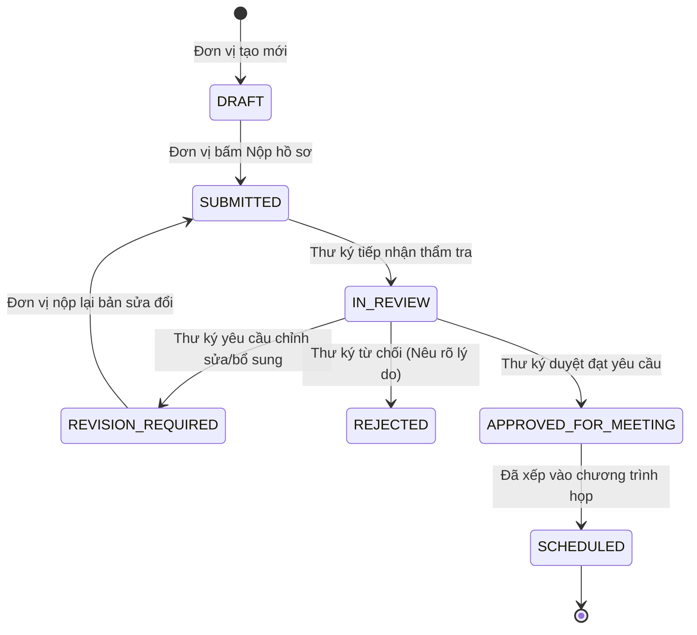
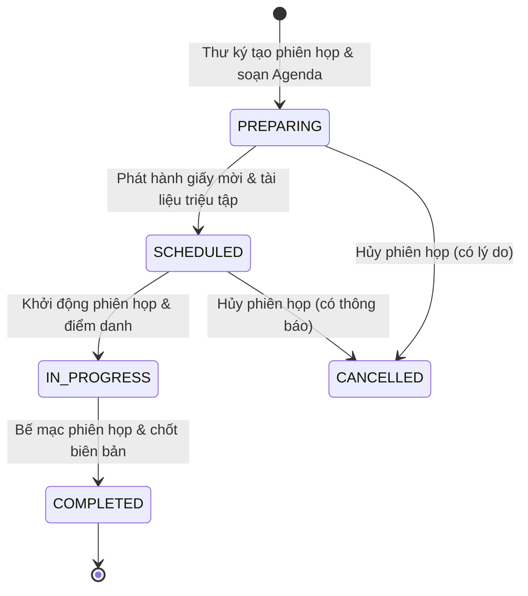
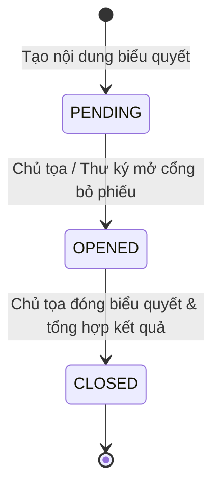
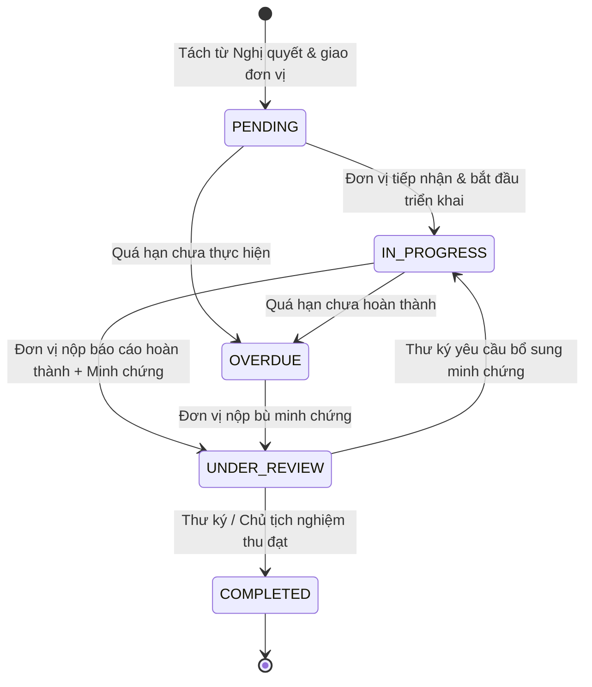

# QUY TẮC NGHIỆP VỤ HỆ THỐNG (BUSINESS RULES)
**Dự án:** Ứng dụng web hỗ trợ quản lý phiên họp và thực hiện nghị quyết của Hội đồng trường STU  
**Phiên bản:** 1.0  
**Trạng thái:** Bản chuẩn hóa nghiệp vụ  

---

## 1. Chuỗi nghiệp vụ cốt lõi (Core Business Workflow)

Hệ thống vận hành theo quy trình khép kín chặt chẽ:
```
[1. HỒ SƠ TRÌNH]
  - Đơn vị khởi tạo tờ trình & tài liệu đính kèm
  - Nộp hồ sơ lên Thư ký HĐT
  - Thư ký HĐT thẩm tra tính hợp lệ
       │ (Hồ sơ đạt yêu cầu)
       ▼
[2. PHIÊN HỌP]
  - Thư ký lập lịch phiên họp & chương trình họp (Agenda)
  - Đưa hồ sơ đã duyệt vào danh mục thảo luận
  - Phát hành giấy triệu tập (Thành viên chính thức & Khách mời)
  - Điểm danh đại biểu có mặt thực tế
       │ (Phiên họp diễn ra)
       ▼
[3. BIỂU QUYẾT]
  - Chủ tọa / Thư ký mở nội dung biểu quyết
  - CHỈ THÀNH VIÊN HĐT CÓ MẶT mới được cấp quyền bỏ phiếu
  - Khách mời TUYỆT ĐỐI KHÔNG CÓ QUYỀN BIỂU QUYẾT
  - Bỏ phiếu công khai hoặc Bỏ phiếu kín
  - Đóng biểu quyết, tự động tổng hợp kết quả & lập biên bản kiểm phiếu
       │ (Biểu quyết thông qua)
       ▼
[4. BIÊN BẢN & NGHỊ QUYẾT]
  - Thư ký lập Biên bản phiên họp
  - Soạn thảo dự thảo Nghị quyết theo kết quả biểu quyết
  - Chủ tịch HĐT phê duyệt & ký ban hành (Cấp số hiệu, ngày ký)
  - Đăng tải văn bản chính thức (file scan/ký số)
       │ (Nghị quyết có hiệu lực)
       ▼
[5. PHÂN RÃ NHIỆM VỤ]
  - Tách các điều khoản Nghị quyết thành các đầu việc (Tasks)
  - Phân công Đơn vị chủ trì, Đơn vị phối hợp, Hạn hoàn thành (Deadline)
       │ (Triển khai thi hành)
       ▼
[6. THỰC HIỆN & BÁO CÁO KẾT QUẢ]
  - Đơn vị cập nhật % tiến độ thực hiện định kỳ
  - Tải lên văn bản minh chứng hoàn thành
  - Thư ký / Chủ tịch nghiệm thu, đánh giá kết quả
```

---

## 2. Quy tắc chi tiết từng thực thể nghiệp vụ

### 2.1. Quy tắc về Hồ sơ trình (Dossiers)
* **BR-DOS-01 (Thẩm quyền nộp):** Chỉ tài khoản đại diện đơn vị (`UNIT_REP`) mới có quyền tạo mới và nộp hồ sơ trình thuộc phạm vi đơn vị mình phụ trách.
* **BR-DOS-02 (Tài liệu đính kèm bắt buộc):** Mỗi hồ sơ trình bắt buộc phải có ít nhất 01 tệp tờ trình chính (định dạng PDF hoặc DOCX/DOC). Dung lượng tối đa mỗi tệp là 50MB.
* **BR-DOS-03 (Tính bất biến khi đã nộp):** Khi hồ sơ chuyển sang trạng thái `Đã nộp` (`SUBMITTED`), đơn vị trình **không được phép chỉnh sửa nội dung hoặc thay thế tệp** trừ khi Thư ký HĐT yêu cầu bổ sung/chỉnh sửa.
* **BR-DOS-04 (Quy trình thẩm tra):**
  * Thư ký tiếp nhận và kiểm tra tính hợp lệ về mặt thẩm quyền, thể thức và căn cứ pháp lý.
  * Nếu đạt: Thư ký chuyển trạng thái sang `Đạt - Sẵn sàng xếp lịch` (`APPROVED_FOR_MEETING`).
  * Nếu chưa đạt: Thư ký chuyển sang `Yêu cầu bổ sung` (`REVISION_REQUIRED`) kèm lý do chi tiết bằng văn bản; đơn vị được quyền sửa đổi và nộp lại phiên bản mới.
  * Nếu không thuộc thẩm quyền HĐT: Thư ký chuyển sang `Từ chối` (`REJECTED`) kèm căn cứ pháp lý.
* **BR-DOS-05 (Điều kiện đưa vào phiên họp):** **CHỈ CÓ** các hồ sơ ở trạng thái `APPROVED_FOR_MEETING` mới được phép đưa vào chương trình nghị sự (Agenda) của một phiên họp.

### 2.2. Quy tắc về Phiên họp (Meetings)
* **BR-MTG-01 (Kỳ họp):** Phiên họp được phân loại thành:
  * `REGULAR`: Họp định kỳ theo quy chế tổ chức và hoạt động của trường.
  * `EXTRAORDINARY`: Họp chuyên đề hoặc bất thường theo yêu cầu của Chủ tịch HĐT hoặc theo đề nghị bằng văn bản của tối thiểu số lượng thành viên theo quy chế.
* **BR-MTG-02 (Thành phần tham dự):**
  * **Thành viên chính thức (Official Members):** Tự động tải từ danh sách thành viên đương nhiệm của HĐT khóa hiện tại.
  * **Khách mời (Guests):** Bao gồm đại diện đơn vị trình hồ sơ, chuyên gia hoặc đại diện tổ chức liên quan. Khách mời được mời theo từng nội dung cụ thể.
* **BR-MTG-03 (Phân phối và bảo mật tài liệu):**
  * Tài liệu phiên họp được chia thành 2 mức độ: `INTERNAL` (Nội bộ HĐT) và `PUBLIC_AGENDA` (Công khai cho khách mời theo nội dung).
  * Khách mời chỉ được tải về và xem tài liệu thuộc mục chương trình mà họ được mời tham dự.
* **BR-MTG-04 (Điều kiện tiến hành phiên họp - Quorum):**
  * Phiên họp chỉ hợp lệ khi số lượng thành viên HĐT có mặt tham dự đạt tỷ lệ tối thiểu theo quy chế hoạt động của STU.
  * *(Đề xuất kỹ thuật & Tham số hệ thống: Mặc định tối thiểu $2/3$ tổng số thành viên HĐT theo quy chế, hệ thống hỗ trợ cấu hình linh hoạt tham số này).*
* **BR-MTG-05 (Điểm danh):** Thư ký thực hiện điểm danh trước khi phiên họp chính thức bắt đầu. Trạng thái điểm danh gồm: `PRESENT` (Có mặt), `ABSENT` (Vắng mặt), `EXCUSED` (Vắng có lý do).

### 2.3. Quy tắc về Biểu quyết & Kiểm phiếu (Voting)
* **BR-VOT-01 (Quyền biểu quyết):**
  * **CHỈ THÀNH VIÊN HỘI ĐỒNG TRƯỜNG ĐÃ ĐIỂM DANH CÓ MẶT (`PRESENT`) MỚI CÓ QUYỀN BIỂU QUYẾT.**
  * **KHÁCH MỜI, THƯ KÝ KHÔNG PHẢI THÀNH VIÊN, ĐẠI DIỆN ĐƠN VỊ TRÌNH TUYỆT ĐỐI KHÔNG CÓ QUYỀN BIỂU QUYẾT.**
* **BR-VOT-02 (Nguyên tắc bỏ phiếu):**
  * Mỗi thành viên có quyền biểu quyết chỉ được bỏ **duy nhất 01 phiếu** cho mỗi nội dung.
  * Phiếu đã gửi lên máy chủ là **bất biến**, không thể thu hồi hoặc sửa đổi.
* **BR-VOT-03 (Hình thức biểu quyết):**
  * `OPEN` (Biểu quyết công khai): Kết quả hiển thị rõ danh sách thành viên và phương án đã chọn sau khi đóng biểu quyết.
  * `SECRET` (Bỏ phiếu kín): Hệ thống lưu nhận diện đã bỏ phiếu của thành viên (để chống bỏ phiếu 2 lần) nhưng **mã hóa/tách biệt hoàn toàn** liên kết giữa định danh thành viên và phương án lựa chọn trong CSDL. Biên bản kiểm phiếu chỉ thể hiện tổng số phiếu của từng phương án, không thể truy vết ai đã chọn phương án nào.
* **BR-VOT-04 (Quy tắc tính tỷ lệ thông qua):**
  * **Đặc tả tính linh hoạt theo quy chế:** Hệ thống cấu hình tỷ lệ thông qua dạng tham số động (`pass_threshold_percentage`) cho từng nội dung biểu quyết:
    * *Biểu quyết thông thường:* Đạt khi số phiếu tán thành $> 50\%$ (quá bán).
    * *Biểu quyết đặc biệt (Quy chế, nhân sự chủ chốt, tài chính lớn):* Đạt khi số phiếu tán thành $\ge 65\%$ hoặc $\ge 75\%$ theo quy định cụ thể của STU.
  * Tùy chọn căn cứ tính mẫu số: Tính trên **Tổng số thành viên HĐT theo quy chế** hoặc tính trên **Số thành viên có mặt tại phiên họp**. Mặc định hệ thống cho phép Thư ký/Chủ tọa chọn căn cứ trước khi mở biểu quyết.
* **BR-VOT-05 (Khóa kết quả):** Sau khi Chủ tọa bấm nút "Đóng biểu quyết", cổng nhận phiếu lập tức đóng lại; hệ thống tính toán kết quả tự động và sinh mã băm toàn vẹn (checksum) cho biên bản kiểm phiếu.

### 2.4. Quy tắc về Biên bản & Nghị quyết (Resolutions)
* **BR-RES-01 (Biên bản phiên họp):** Biên bản phiên họp phải ghi nhận đầy đủ danh sách đại biểu có mặt, nội dung thảo luận, ý kiến bảo lưu (nếu có) và bảng tổng hợp kết quả biểu quyết của tất cả các nội dung.
* **BR-RES-02 (Căn cứ ban hành Nghị quyết):** Mỗi Nghị quyết ban hành bắt buộc phải liên kết với một Phiên họp cụ thể và dựa trên nội dung biểu quyết đã được thông qua (`PASSED`).
* **BR-RES-03 (Quy tắc đánh số Nghị quyết):**
  * Định dạng số hiệu hành chính chuẩn của STU: `[Số thứ tự]/NQ-HĐTSTU`.
  * Số thứ tự tự động tăng theo từng năm dương lịch (reset về 1 vào ngày đầu tiên của năm mới) hoặc duy trì liên tục theo khóa/nhiệm kỳ tùy cấu hình văn thư.
* **BR-RES-04 (Hiệu lực ban hành):**
  * Nghị quyết chỉ có hiệu lực thi hành kể từ ngày ký ban hành hoặc ngày quy định cụ thể trong nội dung văn bản.
  * Tệp đính kèm văn bản Nghị quyết bắt buộc phải là tệp định dạng PDF chính thức có chữ ký của Chủ tịch Hội đồng trường và đóng dấu hợp pháp.
* **BR-RES-05 (Phân phối nghị quyết):** Khi Nghị quyết được chuyển sang trạng thái `ISSUED` (Đã ban hành), hệ thống tự động gửi thông báo đến các đơn vị, cá nhân liên quan và Văn phòng Hiệu trưởng.

### 2.5. Quy tắc về Nhiệm vụ & Theo dõi thi hành (Tasks & Execution)
* **BR-TSK-01 (Nguồn gốc nhiệm vụ):** Mỗi nhiệm vụ bắt buộc phải trích xuất từ ít nhất một điều khoản cụ thể của một Nghị quyết đã ban hành (`ISSUED`).
* **BR-TSK-02 (Phân công trách nhiệm):**
  * Bắt buộc chỉ định **01 Đơn vị chủ trì** (`lead_department_id`).
  * Có thể chỉ định nhiều **Đơn vị phối hợp** (`cooperating_departments`).
  * Bắt buộc có **Hạn chót hoàn thành** (`due_date`).
* **BR-TSK-03 (Tiến độ và Báo cáo):**
  * Đơn vị chủ trì chịu trách nhiệm cập nhật tỷ lệ hoàn thành ($0\% \le \text{tiến độ} \le 100\%$).
  * Khi tiến độ chuyển sang $100\%$ hoặc khi gửi báo cáo định kỳ, đơn vị bắt buộc phải tải lên ít nhất 01 tệp minh chứng (`TaskEvidence`).
* **BR-TSK-04 (Nghiệm thu hoàn thành):** Nhiệm vụ chỉ được chuyển sang trạng thái `COMPLETED` (Đã hoàn thành) khi Thư ký hoặc Chủ tịch HĐT kiểm tra minh chứng và bấm duyệt nghiệm thu. Nếu minh chứng chưa đạt, Thư ký có quyền trả lời yêu cầu bổ sung.
* **BR-TSK-05 (Cảnh báo quá hạn tự động):**
  * Hệ thống tự động so khớp ngày hiện tại với `due_date`. Nếu ngày hiện tại vượt quá `due_date` mà nhiệm vụ chưa ở trạng thái `COMPLETED`, hệ thống tự động gán nhãn `OVERDUE` (Quá hạn) và đổi màu cảnh báo đỏ trên Dashboard.

---

## 3. Máy trạng thái các thực thể (State Machine & Transitions)

### 3.1. Vòng đời Hồ sơ trình (Dossier Status)


### 3.2. Vòng đời Phiên họp (Meeting Status)


### 3.3. Vòng đời Nội dung Biểu quyết (Voting Status)


### 3.4. Vòng đời Nhiệm vụ Nghị quyết (Task Status)


---

## 4. Ma trận phân quyền chi tiết (RACI & Permissions Matrix)

| Nhóm chức năng | Tác vụ cụ thể | Admin | Chủ tịch HĐT | Thư ký HĐT | Thành viên HĐT | Đơn vị trình | Đơn vị thực hiện | VP Hiệu trưởng | Khách mời |
|:---|:---|:---:|:---:|:---:|:---:|:---:|:---:|:---:|:---:|
| **Người dùng & Hệ thống** | Quản lý tài khoản, phân quyền, xem Audit Log | **A/R** | I | I | - | - | - | - | - |
| **Nhiệm kỳ & Thành viên**| Quản lý khóa HĐT, thêm/sửa thành viên HĐT | **C** | **A** | **R** | I | - | - | I | - |
| **Hồ sơ trình** | Tạo tờ trình, đính kèm file, nộp hồ sơ | - | I | I | - | **A/R** | - | - | - |
| | Thẩm tra hồ sơ (Duyệt/Yêu cầu sửa/Từ chối) | - | I | **A/R** | - | I | - | - | - |
| **Phiên họp** | Lập lịch, tạo chương trình họp, gửi triệu tập | - | **A** | **R** | I | I | I | I | I |
| | Điểm danh thành phần tham dự | - | C | **A/R** | I | I | - | - | I |
| | Xem tài liệu họp nội bộ HĐT | - | **R** | **R** | **R** | - | - | I | - |
| | Xem tài liệu họp công khai theo nội dung | - | **R** | **R** | **R** | **R** | - | **R** | **R** |
| **Biểu quyết** | Tạo nội dung, cấu hình hình thức (kín/hở) | - | **A** | **R** | - | - | - | - | - |
| | Mở / Đóng cổng nhận phiếu biểu quyết | - | **A/R** | **R** | - | - | - | - | - |
| | **Thực hiện bỏ phiếu biểu quyết** | - | **R** | **R**(*) | **R** | **FORBIDDEN** | **FORBIDDEN** | **FORBIDDEN** | **FORBIDDEN** |
| | Xem kết quả kiểm phiếu & xuất biên bản | - | **R** | **R** | **R** | I | - | I | - |
| **Biên bản & Nghị quyết** | Lập biên bản phiên họp | - | C | **A/R** | I | - | - | I | - |
| | Duyệt biên bản & ký ban hành Nghị quyết | - | **A/R** | C | I | - | - | I | - |
| | Xem, tra cứu Nghị quyết đã ban hành | **R** | **R** | **R** | **R** | **R** | **R** | **R** | - |
| **Nhiệm vụ & Tiến độ** | Phân rã nhiệm vụ từ nghị quyết, gán deadline | - | **A** | **R** | I | - | I | I | - |
| | Cập nhật % tiến độ, nộp báo cáo & minh chứng | - | - | - | - | - | **A/R** | - | - |
| | Đánh giá, duyệt nghiệm thu hoàn thành nhiệm vụ| - | **A** | **R** | - | - | I | I | - |

*(Ghi chú: A = Accountable - Chịu trách nhiệm chính/Phê duyệt; R = Responsible - Người thực hiện; C = Consulted - Người tham vấn; I = Informed - Người nhận thông tin; `*` = Thư ký chỉ bỏ phiếu nếu là Thành viên HĐT chính thức).*

---

## 5. Xử lý các tình huống ngoại lệ (Exception Handling)

1. **Thành viên HĐT vắng mặt trong phiên biểu quyết:**
   * Nếu thành viên bị đánh dấu `ABSENT` khi điểm danh, hệ thống tự động khóa quyền truy cập vào phiên biểu quyết của thành viên đó.
   * Số phiếu vắng mặt được tính vào báo cáo kiểm phiếu theo diện "Không tham gia biểu quyết".
2. **Phiên biểu quyết bị gián đoạn mạng hoặc sự cố kỹ thuật:**
   * Chủ tọa có quyền bấm nút "Tạm dừng" hoặc "Gia hạn thời gian biểu quyết".
   * Các phiếu bầu đã gửi thành công trước đó được lưu giữ nguyên vẹn trong CSDL.
3. **Đơn vị nộp báo cáo nhiệm vụ bị trả về:**
   * Khi Thư ký/Chủ tịch bấm "Yêu cầu bổ sung minh chứng", trạng thái nhiệm vụ quay về `IN_PROGRESS`.
   * Hệ thống tự động gửi thông báo đến đại diện đơn vị kèm nội dung nhận xét cụ thể để đơn vị chỉnh sửa và gửi lại.
