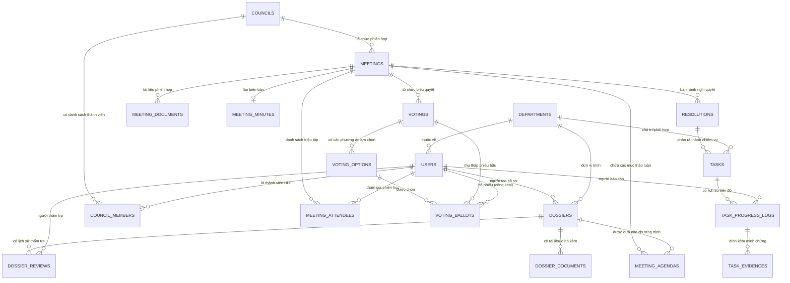

# THIẾT KẾ CƠ SỞ DỮ LIỆU (DATABASE DESIGN)
**Dự án:** Ứng dụng web hỗ trợ quản lý phiên họp và thực hiện nghị quyết của Hội đồng trường STU  
**Hệ quản trị CSDL:** MySQL 9.1 / 8.0 (Engine: InnoDB, Charset: utf8mb4, Collation: utf8mb4_unicode_ci)  
**Phiên bản:** 1.0  
**Trạng thái:** Bản chuẩn hóa lược đồ  

---

## 1. Sơ đồ Quan hệ Thực thể (Entity-Relationship Diagram - ERD)

---

## 2. Danh mục Bảng Dữ liệu Chi tiết

### 2.1. Phân hệ Người dùng, Tổ chức & Phân quyền

#### Bảng `departments` (Đơn vị / Phòng / Ban / Khoa thuộc STU)
| Tên cột | Kiểu dữ liệu | Nullable | Mặc định | Khóa | Diễn giải |
|:---|:---|:---:|:---:|:---:|:---|
| `id` | BIGINT UNSIGNED | NO | Auto Increment | PK | Khóa chính |
| `code` | VARCHAR(50) | NO | | UNIQUE | Mã đơn vị (ví dụ: `P_DT`, `K_CNTT`, `VP_BGH`) |
| `name` | VARCHAR(255) | NO | | | Tên đầy đủ đơn vị |
| `email` | VARCHAR(150) | YES | NULL | | Email liên hệ chính thức |
| `phone` | VARCHAR(20) | YES | NULL | | Số điện thoại nội bộ |
| `is_active` | BOOLEAN | NO | TRUE | | Trạng thái hoạt động |
| `created_at` | TIMESTAMP | YES | NULL | | Thời điểm tạo |
| `updated_at` | TIMESTAMP | YES | NULL | | Thời điểm cập nhật |

#### Bảng `users` (Tài khoản người dùng)
| Tên cột | Kiểu dữ liệu | Nullable | Mặc định | Khóa | Diễn giải |
|:---|:---|:---:|:---:|:---:|:---|
| `id` | BIGINT UNSIGNED | NO | Auto Increment | PK | Khóa chính |
| `department_id` | BIGINT UNSIGNED | YES | NULL | FK | Liên kết bảng `departments(id)` |
| `username` | VARCHAR(100) | NO | | UNIQUE | Tên đăng nhập |
| `email` | VARCHAR(150) | NO | | UNIQUE | Địa chỉ email chính thức |
| `password` | VARCHAR(255) | NO | | | Mật khẩu mã hóa (bcrypt) |
| `full_name` | VARCHAR(150) | NO | | | Họ và tên |
| `academic_title` | VARCHAR(50) | YES | NULL | | Học hàm, học vị (GS, PGS, TS, ThS) |
| `phone` | VARCHAR(20) | YES | NULL | | Số điện thoại di động |
| `avatar_path` | VARCHAR(255) | YES | NULL | | Đường dẫn ảnh đại diện |
| `is_active` | BOOLEAN | NO | TRUE | | Trạng thái tài khoản |
| `remember_token` | VARCHAR(100) | YES | NULL | | Token ghi nhớ đăng nhập |
| `created_at` | TIMESTAMP | YES | NULL | | Thời điểm tạo |
| `updated_at` | TIMESTAMP | YES | NULL | | Thời điểm cập nhật |

*(Lưu ý: Bảng `roles`, `permissions`, `model_has_roles`, `role_has_permissions` được khởi tạo và quản lý theo chuẩn Spatie Laravel-Permission).*

---

### 2.2. Phân hệ Hội đồng trường & Thành viên

#### Bảng `councils` (Khóa / Nhiệm kỳ Hội đồng trường)
| Tên cột | Kiểu dữ liệu | Nullable | Mặc định | Khóa | Diễn giải |
|:---|:---|:---:|:---:|:---:|:---|
| `id` | BIGINT UNSIGNED | NO | Auto Increment | PK | Khóa chính |
| `term_code` | VARCHAR(50) | NO | | UNIQUE | Mã nhiệm kỳ (ví dụ: `TERM_2020_2025`) |
| `term_name` | VARCHAR(150) | NO | | | Tên nhiệm kỳ (ví dụ: `Hội đồng trường Nhiệm kỳ IV`) |
| `start_date` | DATE | NO | | | Ngày bắt đầu nhiệm kỳ |
| `end_date` | DATE | NO | | | Ngày kết thúc nhiệm kỳ |
| `is_current` | BOOLEAN | NO | FALSE | | Đang là nhiệm kỳ đương nhiệm |
| `total_members` | INT UNSIGNED | NO | 0 | | Tổng số thành viên theo quyết định thành lập |
| `created_at` | TIMESTAMP | YES | NULL | | Thời điểm tạo |
| `updated_at` | TIMESTAMP | YES | NULL | | Thời điểm cập nhật |

#### Bảng `council_members` (Thành viên Hội đồng trường)
| Tên cột | Kiểu dữ liệu | Nullable | Mặc định | Khóa | Diễn giải |
|:---|:---|:---:|:---:|:---:|:---|
| `id` | BIGINT UNSIGNED | NO | Auto Increment | PK | Khóa chính |
| `council_id` | BIGINT UNSIGNED | NO | | FK | Liên kết bảng `councils(id)` |
| `user_id` | BIGINT UNSIGNED | NO | | FK | Liên kết bảng `users(id)` |
| `position` | VARCHAR(50) | NO | 'MEMBER' | | Chức vụ HĐT (`CHAIR`, `VICE_CHAIR`, `SECRETARY`, `MEMBER`) |
| `representing` | VARCHAR(150) | YES | NULL | | Đại diện khối (Giảng viên, Quản lý, Doanh nghiệp) |
| `appointed_date` | DATE | YES | NULL | | Ngày bổ nhiệm vào HĐT |
| `status` | VARCHAR(30) | NO | 'ACTIVE' | | Trạng thái (`ACTIVE`, `SUSPENDED`, `DISMISSED`) |
| `created_at` | TIMESTAMP | YES | NULL | | Thời điểm tạo |
| `updated_at` | TIMESTAMP | YES | NULL | | Thời điểm cập nhật |
| *Ràng buộc:* | `UNIQUE(council_id, user_id)` | | | | Một người chỉ có 1 hồ sơ trong 1 nhiệm kỳ |

---

### 2.3. Phân hệ Hồ sơ trình & Thẩm tra

#### Bảng `dossiers` (Hồ sơ trình)
| Tên cột | Kiểu dữ liệu | Nullable | Mặc định | Khóa | Diễn giải |
|:---|:---|:---:|:---:|:---:|:---|
| `id` | BIGINT UNSIGNED | NO | Auto Increment | PK | Khóa chính |
| `dossier_code` | VARCHAR(50) | NO | | UNIQUE | Mã hồ sơ (ví dụ: `HST-2026-001`) |
| `title` | VARCHAR(255) | NO | | | Tiêu đề hồ sơ / tờ trình |
| `summary` | TEXT | NO | | | Trích yếu nội dung đề xuất |
| `legal_basis` | TEXT | YES | NULL | | Căn cứ pháp lý / quy chế viện dẫn |
| `department_id` | BIGINT UNSIGNED | NO | | FK | Đơn vị trình (`departments.id`) |
| `submitter_id` | BIGINT UNSIGNED | NO | | FK | Người tạo / đại diện nộp (`users.id`) |
| `category` | VARCHAR(100) | NO | 'ORGANIZATION'| | Nhóm vấn đề (`PERSONNEL`, `FINANCE`, `STRATEGY`, ...) |
| `status` | VARCHAR(50) | NO | 'DRAFT' | | Trạng thái (`DRAFT`, `SUBMITTED`, `IN_REVIEW`, `APPROVED_FOR_MEETING`, `REVISION_REQUIRED`, `REJECTED`, `SCHEDULED`) |
| `submitted_at` | TIMESTAMP | YES | NULL | | Thời điểm nộp chính thức |
| `created_at` | TIMESTAMP | YES | NULL | | Thời điểm tạo |
| `updated_at` | TIMESTAMP | YES | NULL | | Thời điểm cập nhật |

#### Bảng `dossier_documents` (Tài liệu đính kèm hồ sơ)
| Tên cột | Kiểu dữ liệu | Nullable | Mặc định | Khóa | Diễn giải |
|:---|:---|:---:|:---:|:---:|:---|
| `id` | BIGINT UNSIGNED | NO | Auto Increment | PK | Khóa chính |
| `dossier_id` | BIGINT UNSIGNED | NO | | FK | Liên kết bảng `dossiers(id)` |
| `file_name` | VARCHAR(255) | NO | | | Tên tệp gốc khi tải lên |
| `file_path` | VARCHAR(500) | NO | | | Đường dẫn lưu trữ an toàn (private) |
| `file_type` | VARCHAR(50) | NO | | | Định dạng MIME (pdf, docx, ...) |
| `file_size` | BIGINT UNSIGNED | NO | | | Dung lượng tệp (bytes) |
| `is_main` | BOOLEAN | NO | FALSE | | Là tệp Tờ trình chính |
| `created_at` | TIMESTAMP | YES | NULL | | Thời điểm tải lên |

#### Bảng `dossier_reviews` (Lịch sử thẩm tra hồ sơ)
| Tên cột | Kiểu dữ liệu | Nullable | Mặc định | Khóa | Diễn giải |
|:---|:---|:---:|:---:|:---:|:---|
| `id` | BIGINT UNSIGNED | NO | Auto Increment | PK | Khóa chính |
| `dossier_id` | BIGINT UNSIGNED | NO | | FK | Liên kết bảng `dossiers(id)` |
| `reviewer_id` | BIGINT UNSIGNED | NO | | FK | Thư ký thẩm tra (`users.id`) |
| `decision` | VARCHAR(50) | NO | | | Kết luận (`APPROVED`, `REVISION_REQUESTED`, `REJECTED`) |
| `comments` | TEXT | NO | | | Ý kiến thẩm tra / yêu cầu bổ sung |
| `created_at` | TIMESTAMP | YES | NULL | | Thời điểm thực hiện thẩm tra |

---

### 2.4. Phân hệ Phiên họp, Chương trình & Điểm danh

#### Bảng `meetings` (Phiên họp Hội đồng trường)
| Tên cột | Kiểu dữ liệu | Nullable | Mặc định | Khóa | Diễn giải |
|:---|:---|:---:|:---:|:---:|:---|
| `id` | BIGINT UNSIGNED | NO | Auto Increment | PK | Khóa chính |
| `council_id` | BIGINT UNSIGNED | NO | | FK | Khóa HĐT tổ chức (`councils.id`) |
| `meeting_code` | VARCHAR(50) | NO | | UNIQUE | Mã phiên họp (ví dụ: `PH-2026-K4-01`) |
| `title` | VARCHAR(255) | NO | | | Tên phiên họp (ví dụ: Phiên họp lần thứ 5 HĐT) |
| `meeting_type` | VARCHAR(50) | NO | 'REGULAR' | | Loại hình (`REGULAR`, `EXTRAORDINARY`) |
| `meeting_format`| VARCHAR(50) | NO | 'IN_PERSON'| | Hình thức (`IN_PERSON`, `ONLINE`, `HYBRID`) |
| `location` | VARCHAR(255) | YES | NULL | | Địa điểm phòng họp hoặc link trực tuyến |
| `start_time` | DATETIME | NO | | | Thời gian bắt đầu |
| `end_time` | DATETIME | YES | NULL | | Thời gian dự kiến kết thúc |
| `status` | VARCHAR(50) | NO | 'PREPARING'| | Trạng thái (`PREPARING`, `SCHEDULED`, `IN_PROGRESS`, `COMPLETED`, `CANCELLED`) |
| `chairperson_id`| BIGINT UNSIGNED | NO | | FK | Chủ tọa phiên họp (`users.id`) |
| `secretary_id` | BIGINT UNSIGNED | NO | | FK | Thư ký phiên họp (`users.id`) |
| `created_at` | TIMESTAMP | YES | NULL | | Thời điểm tạo |
| `updated_at` | TIMESTAMP | YES | NULL | | Thời điểm cập nhật |

#### Bảng `meeting_agendas` (Chương trình nghị sự phiên họp)
| Tên cột | Kiểu dữ liệu | Nullable | Mặc định | Khóa | Diễn giải |
|:---|:---|:---:|:---:|:---:|:---|
| `id` | BIGINT UNSIGNED | NO | Auto Increment | PK | Khóa chính |
| `meeting_id` | BIGINT UNSIGNED | NO | | FK | Liên kết bảng `meetings(id)` |
| `dossier_id` | BIGINT UNSIGNED | YES | NULL | FK | Hồ sơ trình thảo luận (`dossiers.id`) |
| `item_order` | INT UNSIGNED | NO | 1 | | Số thứ tự mục trong chương trình |
| `title` | VARCHAR(255) | NO | | | Nội dung thảo luận |
| `presenter` | VARCHAR(150) | YES | NULL | | Người trình bày báo cáo |
| `duration_minutes`| INT UNSIGNED | YES | 30 | | Thời lượng dự kiến (phút) |
| `is_voting_required`| BOOLEAN | NO | FALSE | | Có yêu cầu biểu quyết hay không |
| `created_at` | TIMESTAMP | YES | NULL | | Thời điểm tạo |
| `updated_at` | TIMESTAMP | YES | NULL | | Thời điểm cập nhật |

#### Bảng `meeting_attendees` (Thành phần triệu tập & Điểm danh)
| Tên cột | Kiểu dữ liệu | Nullable | Mặc định | Khóa | Diễn giải |
|:---|:---|:---:|:---:|:---:|:---|
| `id` | BIGINT UNSIGNED | NO | Auto Increment | PK | Khóa chính |
| `meeting_id` | BIGINT UNSIGNED | NO | | FK | Liên kết bảng `meetings(id)` |
| `user_id` | BIGINT UNSIGNED | NO | | FK | Người tham gia (`users.id`) |
| `attendee_type` | VARCHAR(50) | NO | 'OFFICIAL' | | Loại tham dự (`OFFICIAL` - Thành viên HĐT, `GUEST` - Khách mời) |
| `attendance_status`| VARCHAR(50)| NO | 'INVITED' | | Điểm danh (`INVITED`, `PRESENT`, `ABSENT`, `EXCUSED`) |
| `can_vote` | BOOLEAN | NO | FALSE | | **Cờ quyền biểu quyết: TRUE duy nhất cho thành viên HĐT có mặt** |
| `checkin_time` | DATETIME | YES | NULL | | Thời điểm điểm danh có mặt |
| `notes` | VARCHAR(255) | YES | NULL | | Ghi chú (lý do vắng mặt...) |
| *Ràng buộc:* | `UNIQUE(meeting_id, user_id)` | | | | Không thêm trùng lặp 1 người trong 1 phiên |

#### Bảng `meeting_documents` (Tài liệu phiên họp)
| Tên cột | Kiểu dữ liệu | Nullable | Mặc định | Khóa | Diễn giải |
|:---|:---|:---:|:---:|:---:|:---|
| `id` | BIGINT UNSIGNED | NO | Auto Increment | PK | Khóa chính |
| `meeting_id` | BIGINT UNSIGNED | NO | | FK | Liên kết bảng `meetings(id)` |
| `agenda_id` | BIGINT UNSIGNED | YES | NULL | FK | Mục chương trình liên quan (`meeting_agendas.id`) |
| `file_name` | VARCHAR(255) | NO | | | Tên tệp hiển thị |
| `file_path` | VARCHAR(500) | NO | | | Đường dẫn lưu trữ private |
| `file_size` | BIGINT UNSIGNED | NO | | | Kích thước tệp (bytes) |
| `access_level` | VARCHAR(50) | NO | 'INTERNAL'| | Mức bảo mật (`INTERNAL` - Chỉ HĐT, `PUBLIC_AGENDA` - Cho khách mời) |
| `created_at` | TIMESTAMP | YES | NULL | | Thời điểm tải lên |

---

### 2.5. Phân hệ Biểu quyết & Kiểm phiếu

#### Bảng `votings` (Nội dung biểu quyết)
| Tên cột | Kiểu dữ liệu | Nullable | Mặc định | Khóa | Diễn giải |
|:---|:---|:---:|:---:|:---:|:---|
| `id` | BIGINT UNSIGNED | NO | Auto Increment | PK | Khóa chính |
| `meeting_id` | BIGINT UNSIGNED | NO | | FK | Phiên họp tổ chức (`meetings.id`) |
| `agenda_id` | BIGINT UNSIGNED | YES | NULL | FK | Mục chương trình (`meeting_agendas.id`) |
| `title` | VARCHAR(255) | NO | | | Tiêu đề nội dung biểu quyết |
| `description` | TEXT | YES | NULL | | Mô tả chi tiết vấn đề lấy ý kiến |
| `voting_type` | VARCHAR(50) | NO | 'OPEN' | | Hình thức (`OPEN` - Công khai, `SECRET` - Bỏ phiếu kín) |
| `pass_threshold_percentage`| DECIMAL(5,2)| NO | 50.00 | | Tỷ lệ % tán thành tối thiểu để thông qua (mặc định 50%) |
| `base_calculation`| VARCHAR(50) | NO | 'ATTENDEES'| | Mẫu số tính %: `ATTENDEES` (Có mặt) hoặc `TOTAL_COUNCIL` (Tổng thành viên HĐT) |
| `status` | VARCHAR(50) | NO | 'PENDING' | | Trạng thái (`PENDING`, `OPENED`, `CLOSED`) |
| `opened_at` | DATETIME | YES | NULL | | Thời điểm mở cổng nhận phiếu |
| `closed_at` | DATETIME | YES | NULL | | Thời điểm đóng biểu quyết |
| `total_eligible_voters`| INT UNSIGNED| NO | 0 | | Số người có quyền bỏ phiếu hợp lệ tại thời điểm mở |
| `total_votes_cast`| INT UNSIGNED | NO | 0 | | Tổng số phiếu đã nộp |
| `is_passed` | BOOLEAN | YES | NULL | | Kết luận kết quả: TRUE (Đạt), FALSE (Không đạt) |
| `created_at` | TIMESTAMP | YES | NULL | | Thời điểm tạo |
| `updated_at` | TIMESTAMP | YES | NULL | | Thời điểm cập nhật |

#### Bảng `voting_options` (Phương án lựa chọn biểu quyết)
| Tên cột | Kiểu dữ liệu | Nullable | Mặc định | Khóa | Diễn giải |
|:---|:---|:---:|:---:|:---:|:---|
| `id` | BIGINT UNSIGNED | NO | Auto Increment | PK | Khóa chính |
| `voting_id` | BIGINT UNSIGNED | NO | | FK | Liên kết bảng `votings(id)` |
| `option_text` | VARCHAR(255) | NO | | | Nội dung phương án (Tán thành, Không tán thành, ...) |
| `item_order` | INT UNSIGNED | NO | 1 | | Thứ tự hiển thị |
| `vote_count` | INT UNSIGNED | NO | 0 | | Tổng số phiếu thu về (tự động cộng dồn khi đóng biểu quyết) |

#### Bảng `voting_ballots` (Phiếu bầu)
| Tên cột | Kiểu dữ liệu | Nullable | Mặc định | Khóa | Diễn giải |
|:---|:---|:---:|:---:|:---:|:---|
| `id` | BIGINT UNSIGNED | NO | Auto Increment | PK | Khóa chính |
| `voting_id` | BIGINT UNSIGNED | NO | | FK | Liên kết bảng `votings(id)` |
| `user_id` | BIGINT UNSIGNED | YES | NULL | FK | Người bỏ phiếu (NULL nếu là `SECRET` ballot) |
| `voter_hash` | VARCHAR(128) | NO | | | Mã băm ẩn danh một chiều (dùng để kiểm tra 1 người chỉ bỏ 1 lần trong bỏ phiếu kín) |
| `voting_option_id`| BIGINT UNSIGNED| NO | | FK | Phương án được chọn (`voting_options.id`) |
| `cast_at` | TIMESTAMP | NO | CURRENT_TIMESTAMP| | Thời điểm nộp phiếu |
| *Ràng buộc:* | `UNIQUE(voting_id, voter_hash)` | | | | Chống tuyệt đối hành vi bỏ phiếu 2 lần |

---

### 2.6. Phân hệ Biên bản & Nghị quyết

#### Bảng `meeting_minutes` (Biên bản phiên họp)
| Tên cột | Kiểu dữ liệu | Nullable | Mặc định | Khóa | Diễn giải |
|:---|:---|:---:|:---:|:---:|:---|
| `id` | BIGINT UNSIGNED | NO | Auto Increment | PK | Khóa chính |
| `meeting_id` | BIGINT UNSIGNED | NO | | FK, UNIQUE| Mỗi phiên họp có duy nhất 1 biên bản chính |
| `minute_code` | VARCHAR(50) | NO | | UNIQUE | Số biên bản (ví dụ: `BB-2026-01/HĐT`) |
| `content` | LONGTEXT | NO | | | Nội dung chi tiết diễn biến, kết luận cuộc họp |
| `signatory_chair_id`| BIGINT UNSIGNED| YES| NULL | FK | Chủ tịch duyệt ký (`users.id`) |
| `signatory_secretary_id`| BIGINT UNSIGNED| YES| NULL| FK | Thư ký ghi nhận (`users.id`) |
| `file_path` | VARCHAR(500) | YES | NULL | | File biên bản hoàn chỉnh (PDF) |
| `status` | VARCHAR(50) | NO | 'DRAFT' | | Trạng thái (`DRAFT`, `APPROVED`) |
| `created_at` | TIMESTAMP | YES | NULL | | Thời điểm tạo |
| `updated_at` | TIMESTAMP | YES | NULL | | Thời điểm cập nhật |

#### Bảng `resolutions` (Nghị quyết Hội đồng trường)
| Tên cột | Kiểu dữ liệu | Nullable | Mặc định | Khóa | Diễn giải |
|:---|:---|:---:|:---:|:---:|:---|
| `id` | BIGINT UNSIGNED | NO | Auto Increment | PK | Khóa chính |
| `meeting_id` | BIGINT UNSIGNED | NO | | FK | Căn cứ phiên họp (`meetings.id`) |
| `resolution_number`| VARCHAR(100)| NO | | UNIQUE | Số ký hiệu chính thức (ví dụ: `01/NQ-HĐTSTU`) |
| `title` | VARCHAR(255) | NO | | | Tiêu đề / Trích yếu nội dung Nghị quyết |
| `content` | LONGTEXT | YES | NULL | | Toàn văn điều khoản Nghị quyết |
| `issued_date` | DATE | NO | | | Ngày ký ban hành |
| `signer_name` | VARCHAR(150) | NO | | | Họ tên người ký (Chủ tịch HĐT) |
| `signer_title` | VARCHAR(100) | NO | 'Chủ tịch Hội đồng trường' | | Chức danh người ký |
| `file_path` | VARCHAR(500) | NO | | | Tệp văn bản PDF có chữ ký & con dấu chính thức |
| `status` | VARCHAR(50) | NO | 'ISSUED' | | Trạng thái (`DRAFT`, `ISSUED`, `REVOKED`) |
| `created_at` | TIMESTAMP | YES | NULL | | Thời điểm tạo |
| `updated_at` | TIMESTAMP | YES | NULL | | Thời điểm cập nhật |

---

### 2.7. Phân hệ Phân rã Nhiệm vụ & Theo dõi thực hiện

#### Bảng `tasks` (Nhiệm vụ theo Nghị quyết)
| Tên cột | Kiểu dữ liệu | Nullable | Mặc định | Khóa | Diễn giải |
|:---|:---|:---:|:---:|:---:|:---|
| `id` | BIGINT UNSIGNED | NO | Auto Increment | PK | Khóa chính |
| `resolution_id` | BIGINT UNSIGNED | NO | | FK | Nghị quyết gốc (`resolutions.id`) |
| `task_code` | VARCHAR(50) | NO | | UNIQUE | Mã nhiệm vụ (ví dụ: `NV-NQ01-2026-01`) |
| `title` | VARCHAR(255) | NO | | | Tên nhiệm vụ cụ thể |
| `description` | TEXT | YES | NULL | | Mô tả chi tiết nội dung công việc |
| `lead_department_id`| BIGINT UNSIGNED| NO| | FK | Đơn vị chủ trì thực hiện (`departments.id`) |
| `start_date` | DATE | NO | | | Ngày bắt đầu triển khai |
| `due_date` | DATE | NO | | | Hạn chót hoàn thành |
| `progress_percentage`| INT UNSIGNED | NO | 0 | | Tiến độ hiện tại (0% - 100%) |
| `status` | VARCHAR(50) | NO | 'PENDING' | | Trạng thái (`PENDING`, `IN_PROGRESS`, `UNDER_REVIEW`, `COMPLETED`, `OVERDUE`) |
| `priority` | VARCHAR(20) | NO | 'MEDIUM' | | Mức độ ưu tiên (`LOW`, `MEDIUM`, `HIGH`, `URGENT`) |
| `created_at` | TIMESTAMP | YES | NULL | | Thời điểm tạo |
| `updated_at` | TIMESTAMP | YES | NULL | | Thời điểm cập nhật |

#### Bảng `task_cooperating_departments` (Đơn vị phối hợp thực hiện nhiệm vụ)
| Tên cột | Kiểu dữ liệu | Nullable | Mặc định | Khóa | Diễn giải |
|:---|:---|:---:|:---:|:---:|:---|
| `task_id` | BIGINT UNSIGNED | NO | | FK | Nhiệm vụ liên quan |
| `department_id` | BIGINT UNSIGNED | NO | | FK | Đơn vị phối hợp |
| *Ràng buộc:* | `PRIMARY KEY(task_id, department_id)` | | | | Tránh trùng lặp đơn vị phối hợp |

#### Bảng `task_progress_logs` (Nhật ký tiến độ & Báo cáo)
| Tên cột | Kiểu dữ liệu | Nullable | Mặc định | Khóa | Diễn giải |
|:---|:---|:---:|:---:|:---:|:---|
| `id` | BIGINT UNSIGNED | NO | Auto Increment | PK | Khóa chính |
| `task_id` | BIGINT UNSIGNED | NO | | FK | Liên kết bảng `tasks(id)` |
| `reporter_id` | BIGINT UNSIGNED | NO | | FK | Người đại diện đơn vị gửi báo cáo (`users.id`) |
| `progress_percentage`| INT UNSIGNED | NO | | | Tiến độ cập nhật tại thời điểm báo cáo |
| `report_content` | TEXT | NO | | | Nội dung báo cáo chi tiết khối lượng đã làm |
| `review_status` | VARCHAR(50) | NO | 'SUBMITTED'| | Trạng thái duyệt (`SUBMITTED`, `ACCEPTED`, `REJECTED`) |
| `reviewer_feedback`| TEXT | YES | NULL | | Nhận xét của Thư ký/Chủ tịch khi đánh giá |
| `created_at` | TIMESTAMP | YES | NULL | | Thời điểm báo cáo |

#### Bảng `task_evidences` (Tài liệu minh chứng kết quả)
| Tên cột | Kiểu dữ liệu | Nullable | Mặc định | Khóa | Diễn giải |
|:---|:---|:---:|:---:|:---:|:---|
| `id` | BIGINT UNSIGNED | NO | Auto Increment | PK | Khóa chính |
| `task_progress_log_id`| BIGINT UNSIGNED| NO| | FK | Liên kết lần báo cáo (`task_progress_logs.id`) |
| `file_name` | VARCHAR(255) | NO | | | Tên tệp minh chứng gốc |
| `file_path` | VARCHAR(500) | NO | | | Đường dẫn lưu trữ private |
| `file_size` | BIGINT UNSIGNED | NO | | | Dung lượng tệp (bytes) |
| `file_type` | VARCHAR(50) | NO | | | Định dạng (pdf, docx, ...) |
| `created_at` | TIMESTAMP | YES | NULL | | Thời điểm tải lên |

---

### 2.8. Phân hệ Giám sát, Thông báo & Nhật ký

#### Bảng `notifications` (Thông báo người dùng)
| Tên cột | Kiểu dữ liệu | Nullable | Mặc định | Khóa | Diễn giải |
|:---|:---|:---:|:---:|:---:|:---|
| `id` | CHAR(36) | NO | UUID | PK | Khóa chính UUID |
| `user_id` | BIGINT UNSIGNED | NO | | FK | Người nhận thông báo (`users.id`) |
| `type` | VARCHAR(100) | NO | | | Phân loại thông báo |
| `title` | VARCHAR(255) | NO | | | Tiêu đề thông báo |
| `message` | TEXT | NO | | | Nội dung tóm tắt |
| `action_url` | VARCHAR(255) | YES | NULL | | Đường dẫn liên kết trong React frontend |
| `read_at` | TIMESTAMP | YES | NULL | | Thời điểm đọc (NULL = Chưa đọc) |
| `created_at` | TIMESTAMP | YES | NULL | | Thời điểm gửi |

#### Bảng `audit_logs` (Nhật ký kiểm toán hệ thống)
| Tên cột | Kiểu dữ liệu | Nullable | Mặc định | Khóa | Diễn giải |
|:---|:---|:---:|:---:|:---:|:---|
| `id` | BIGINT UNSIGNED | NO | Auto Increment | PK | Khóa chính |
| `user_id` | BIGINT UNSIGNED | YES | NULL | FK | Người thực hiện thao tác (NULL nếu do cronjob) |
| `action` | VARCHAR(100) | NO | | | Hành động (CREATE, UPDATE, DELETE, VOTE, ISSUE, APPROVE) |
| `entity_type` | VARCHAR(100) | NO | | | Bảng bị ảnh hưởng (dossiers, votings, resolutions, ...) |
| `entity_id` | BIGINT UNSIGNED | YES | NULL | | ID bản ghi bị tác động |
| `old_values` | JSON | YES | NULL | | Dữ liệu trước khi sửa/xóa |
| `new_values` | JSON | YES | NULL | | Dữ liệu sau khi thêm/sửa |
| `ip_address` | VARCHAR(45) | YES | NULL | | Địa chỉ IP người dùng |
| `user_agent` | TEXT | YES | NULL | | Trình duyệt & hệ điều hành người dùng |
| `created_at` | TIMESTAMP | NO | CURRENT_TIMESTAMP| | Thời điểm phát sinh thao tác |

---

## 3. Các điểm thiết kế cần lưu ý & Điểm chờ xác nhận

1. **Cơ chế Bỏ phiếu kín (Secret Ballot):**
   * *Giải pháp thiết kế:* Bảng `voting_ballots` sử dụng trường `voter_hash = SHA256(voting_id + user_id + secret_salt)`. Cột `user_id` sẽ được gán giá trị `NULL`.
   * *Kết quả đạt được:* Vừa đảm bảo ràng buộc duy nhất `UNIQUE(voting_id, voter_hash)` để chống 1 người bỏ phiếu 2 lần, vừa ngăn chặn bất kỳ ai (kể cả quản trị viên Database) truy vết xem người dùng cụ thể đã chọn phương án nào.
2. **Quyền biểu quyết của Khách mời:**
   * Trong bảng `meeting_attendees`, cột `can_vote` bắt buộc bằng `FALSE` đối với mọi dòng có `attendee_type = 'GUEST'`. Ràng buộc này được kiểm tra 2 lần: tại Controller/Policy và tại Model Event trước khi lưu vào CSDL.
3. **Điểm cần xác nhận thêm với Nhà trường (STU):**
   * *Quy tắc sinh số Nghị quyết:* Có cần tách riêng nhánh số hiệu cho các loại văn bản khác của HĐT như "Quyết định của HĐT" (`.../QĐ-HĐTSTU`) và "Thông báo của HĐT" (`.../TB-HĐTSTU`) không?
   * *Thời hạn lưu trữ hồ sơ:* Có áp dụng chính sách xóa mềm (Soft Deletes với `deleted_at`) cho toàn bộ các bảng hay chỉ một số bảng danh mục? *(Hiện tại lược đồ khuyến nghị kích hoạt Soft Deletes cho `dossiers`, `meetings`, `resolutions`, `tasks` để chống mất dữ liệu hành chính).*
