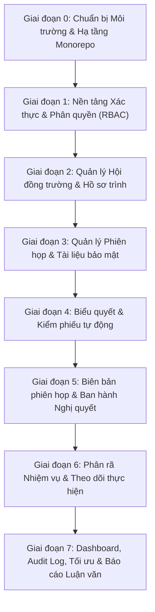

# KẾ HOẠCH TRIỂN KHAI HỆ THỐNG (IMPLEMENTATION PLAN)
**Dự án:** Ứng dụng web hỗ trợ quản lý phiên họp và thực hiện nghị quyết của Hội đồng trường STU  
**Mô hình phát triển:** Lặp và Tăng trưởng (Iterative & Incremental)  
**Phiên bản:** 1.0  
**Trạng thái:** Bản chuẩn hóa kế hoạch  

---

## 1. Biểu đồ Phụ thuộc Module (Module Dependency Graph)

Các module được triển khai tuần tự theo nguyên tắc: **Nền tảng hạ tầng $\longrightarrow$ Dữ liệu danh mục $\longrightarrow$ Nghiệp vụ trước họp $\longrightarrow$ Nghiệp vụ trong họp $\longrightarrow$ Nghiệp vụ sau họp $\longrightarrow$ Báo cáo tổng hợp**.

---

## 2. Kế hoạch Chi tiết từng Giai đoạn

### Giai đoạn 0: Chuẩn bị Môi trường & Bộ khung Monorepo (Sprint 0)
* **Mục tiêu:** Thiết lập môi trường phát triển Windows cục bộ, khởi tạo dự án Git và cấu hình cấu trúc thư mục chuẩn.
* **Các công việc chính:**
  1. Cấu hình biến môi trường `PATH` của Windows để nhận diện `php.exe` (PHP 8.2) và cài đặt `composer.phar`.
  2. Khởi tạo Git repository trong thư mục `D:\WAMP\www\LVTN` kèm `.gitignore` chuẩn.
  3. Khởi tạo dự án Backend Laravel 11 tại `backend/`.
  4. Khởi tạo dự án Frontend React.js (Vite) tại `frontend/`.
  5. Cài đặt các gói phụ thuộc cốt lõi:
     * Backend: `laravel/sanctum`, `spatie/laravel-permission`.
     * Frontend: `antd`, `@ant-design/icons`, `axios`, `react-router-dom`, `dayjs`, `@tanstack/react-query`.
* **Sản phẩm bàn giao:** Bộ khung Monorepo khởi chạy thành công cả frontend lẫn backend.

---

### Giai đoạn 1: Nền tảng Xác thực & Phân quyền RBAC (Sprint 1)
* **Mục tiêu:** Xây dựng hoàn chỉnh phân hệ đăng nhập, cấp token và kiểm soát quyền hạn.
* **Các công việc chính:**
  * **Backend:**
    * Migration bảng `departments`, `users`, bảng vai trò & quyền hạn Spatie.
    * Tạo Enums: `RoleEnum`.
    * Xây dựng `AuthController` (`login`, `logout`, `me`, `change-password`).
    * Viết Seeder khởi tạo danh mục phòng ban mẫu của STU và các tài khoản quản trị/thư ký/chủ tịch mẫu.
  * **Frontend:**
    * Xây dựng `src/services/api.js` (Axios interceptors đính kèm Bearer Token).
    * Xây dựng Auth Context / Zustand Store lưu thông tin đăng nhập.
    * Xây dựng giao diện trang `LoginPage.jsx` mang nhận diện STU.
    * Xây dựng khung giao diện `AdminLayout.jsx` (Sidebar, Header, Breadcrumb, Footer) có phân quyền hiển thị menu.
    * Xây dựng component `<ProtectedRoute />` bảo vệ tuyến đường theo Role.
* **Tiêu chí nghiệm thu (Checklist DoD):**
  - [x] Đăng nhập đúng cấp token, lưu vào LocalStorage/State.
  - [x] Đăng nhập sai báo lỗi trực quan.
  - [x] Đăng xuất hủy token và điều hướng về trang Login.
  - [x] Người dùng đăng nhập chỉ nhìn thấy menu chức năng thuộc vai trò của mình.

---

### Giai đoạn 2: Quản lý Hội đồng trường & Hồ sơ trình (Sprint 2)
* **Mục tiêu:** Quản lý thông tin nhiệm kỳ HĐT và quy trình nộp, thẩm tra hồ sơ tờ trình.
* **Các công việc chính:**
  * **Backend:**
    * Migration: `councils`, `council_members`, `dossiers`, `dossier_documents`, `dossier_reviews`.
    * Tạo Enums: `DossierStatus`.
    * Xây dựng `CouncilMemberController` và `DossierController`.
    * Viết `DossierPolicy`: Đơn vị chỉ sửa được hồ sơ của mình khi ở trạng thái `DRAFT` hoặc `REVISION_REQUIRED`; chỉ Thư ký mới được thẩm tra.
    * Lưu trữ tệp tờ trình vào `storage/app/private/dossiers/`.
  * **Frontend:**
    * Màn hình quản lý nhiệm kỳ và danh sách thành viên HĐT (`MemberListPage.jsx`).
    * Màn hình tạo và nộp hồ sơ trình dành cho đại diện đơn vị (`DossierForm.jsx`).
    * Màn hình danh sách và thẩm tra hồ sơ dành cho Thư ký (`DossierDetailPage.jsx`, Modal thẩm tra).
* **Tiêu chí nghiệm thu (Checklist DoD):**
  - [x] Tạo và quản lý được danh sách thành viên HĐT theo nhiệm kỳ.
  - [x] Đơn vị tải lên được file tờ trình đính kèm và gửi nộp hồ sơ.
  - [x] Hồ sơ đã nộp bị khóa chỉnh sửa.
  - [x] Thư ký thực hiện được 3 nhánh thẩm tra (Duyệt đạt / Yêu cầu sửa / Từ chối).

---

### Giai đoạn 3: Quản lý Phiên họp & Phân phối Tài liệu (Sprint 3)
* **Mục tiêu:** Lập kế hoạch phiên họp, xây dựng chương trình nghị sự (Agenda), quản lý thành phần tham dự, điểm danh và phân phối tài liệu bảo mật.
* **Các công việc chính:**
  * **Backend:**
    * Migration: `meetings`, `meeting_agendas`, `meeting_attendees`, `meeting_documents`.
    * Tạo Enums: `MeetingStatus`.
    * Xây dựng `MeetingController`: Tạo phiên họp, thêm mục chương trình liên kết với hồ sơ đã thẩm tra đạt, điểm danh, phát hành giấy mời.
    * Viết `MeetingPolicy`: Kiểm soát chặt chẽ quyền tải tài liệu nội bộ và quyền biểu quyết của khách mời.
  * **Frontend:**
    * Màn hình danh sách lịch họp (`MeetingListPage.jsx`).
    * Màn hình chi tiết phiên họp (`MeetingDetailPage.jsx`): Quản lý Agenda, danh sách triệu tập, kho tài liệu phiên họp.
    * Giao diện điểm danh đại biểu tham dự trực quan.
* **Tiêu chí nghiệm thu (Checklist DoD):**
  - [x] Tạo được phiên họp và xây dựng danh mục Agenda gắn hồ sơ trình.
  - [x] Tự động tải thành viên HĐT vào danh sách triệu tập; thêm được khách mời.
  - [x] Điểm danh thành viên chính xác.
  - [x] Khách mời không thể tải hoặc xem tài liệu nội bộ HĐT.

---

### Giai đoạn 4: Quản lý Biểu quyết & Kiểm phiếu Tự động (Sprint 4)
* **Mục tiêu:** Vận hành biểu quyết trực tuyến trong phiên họp, kiểm soát quyền bỏ phiếu và tự động tổng hợp kết quả kiểm phiếu.
* **Các công việc chính:**
  * **Backend:**
    * Migration: `votings`, `voting_options`, `voting_ballots`.
    * Tạo Enums: `VotingType` (OPEN, SECRET), `VotingStatus`.
    * Xây dựng `VotingService`: Mở/đóng biểu quyết, kiểm tra điều kiện bỏ phiếu (chỉ thành viên HĐT có mặt), cơ chế băm ẩn danh cho bỏ phiếu kín, tính tỷ lệ % tán thành.
    * Xây dựng `VotingController` và `VotingPolicy`.
  * **Frontend:**
    * Giao diện điều hành biểu quyết dành cho Chủ tọa / Thư ký (`VotingSessionPage.jsx`: nút Mở/Đóng, xem tiến độ nộp phiếu).
    * Giao diện bỏ phiếu dành cho Thành viên HĐT (`BallotCard.jsx`: to rõ, trực quan, hỗ trợ thiết bị cảm ứng).
    * Màn hình xem biên bản và biểu đồ kết quả kiểm phiếu (`VotingResultPage.jsx`).
* **Tiêu chí nghiệm thu (Checklist DoD):**
  - [x] **Khách mời và tài khoản không thuộc HĐT tuyệt đối không thể bỏ phiếu** (bị chặn cả trên UI lẫn API 403).
  - [x] Mỗi thành viên chỉ bỏ phiếu đúng 1 lần cho mỗi nội dung.
  - [x] Bỏ phiếu kín bảo đảm không để lộ liên kết danh tính người chọn phương án trong CSDL.
  - [x] Tự động tính tỷ lệ % và kết luận Đạt/Không đạt chính xác theo cấu hình tham số.

---

### Giai đoạn 5: Biên bản Phiên họp & Ban hành Nghị quyết (Sprint 5)
* **Mục tiêu:** Quản lý biên bản phiên họp, số hóa và phát hành chính thức Nghị quyết Hội đồng trường.
* **Các công việc chính:**
  * **Backend:**
    * Migration: `meeting_minutes`, `resolutions`.
    * Xây dựng `ResolutionService`: Quản lý quy tắc sinh số nghị quyết chuẩn hành chính STU (`.../NQ-HĐTSTU`), tải lên và lưu trữ bản scan chính thức.
    * Xây dựng `ResolutionController`.
  * **Frontend:**
    * Màn hình soạn thảo và duyệt biên bản phiên họp (`MeetingMinuteEditor.jsx`).
    * Màn hình ban hành Nghị quyết (`ResolutionFormModal.jsx`): Cấp số, ngày ký, người ký, tải tệp PDF đã ký duyệt.
    * Màn hình tra cứu và xem văn bản Nghị quyết (`ResolutionListPage.jsx`, `ResolutionDetailPage.jsx`).
* **Tiêu chí nghiệm thu (Checklist DoD):**
  - [x] Lập và lưu trữ biên bản phiên họp hoàn chỉnh.
  - [x] Sinh số nghị quyết duy nhất, đính kèm văn bản scan chính thức.
  - [x] Nghị quyết ban hành hiển thị công khai cho các đơn vị liên quan tra cứu.

---

### Giai đoạn 6: Phân rã Nhiệm vụ & Theo dõi Thi hành (Sprint 6)
* **Mục tiêu:** Tách các điều khoản Nghị quyết thành nhiệm vụ cụ thể, giao việc và theo dõi báo cáo tiến độ, minh chứng từ các đơn vị.
* **Các công việc chính:**
  * **Backend:**
    * Migration: `tasks`, `task_cooperating_departments`, `task_progress_logs`, `task_evidences`.
    * Tạo Enums: `TaskStatus`.
    * Xây dựng `TaskService`: Giao nhiệm vụ, tính toán cảnh báo quá hạn tự động, tiếp nhận báo cáo và duyệt nghiệm thu.
    * Xây dựng `TaskController`.
  * **Frontend:**
    * Màn hình phân công nhiệm vụ từ Nghị quyết (`TaskCreateModal.jsx`).
    * Màn hình quản lý nhiệm vụ dành cho Thư ký và Lãnh đạo (`TaskListPage.jsx` với bộ lọc trạng thái, hạn chót).
    * Màn hình báo cáo tiến độ dành cho đơn vị thực hiện (`TaskProgressForm.jsx`, tải file minh chứng).
    * Màn hình thẩm định và nghiệm thu minh chứng (`TaskDetailPage.jsx`).
* **Tiêu chí nghiệm thu (Checklist DoD):**
  - [x] Tách được nhiều nhiệm vụ từ một nghị quyết, gán đúng đơn vị và deadline.
  - [x] Đơn vị cập nhật được % tiến độ và tải lên tệp minh chứng kết quả.
  - [x] Thư ký/Chủ tịch thực hiện được việc đánh giá, nghiệm thu hoàn thành.
  - [x] Tự động cảnh báo đỏ đối với các nhiệm vụ quá hạn.

---

### Giai đoạn 7: Dashboard, Audit Log, Hoàn thiện & Đóng gói Luận văn (Sprint 7)
* **Mục tiêu:** Hoàn thiện Dashboard phân tích, hệ thống thông báo, nhật ký kiểm toán, kiểm thử toàn diện và chuẩn bị dữ liệu báo cáo tốt nghiệp.
* **Các công việc chính:**
  * **Backend:**
    * Xây dựng `DashboardController`: Tổng hợp số liệu thống kê phiên họp, nghị quyết, tiến độ nhiệm vụ theo đơn vị.
    * Hoàn thiện `AuditLog`: Tự động ghi vết các thao tác thay đổi dữ liệu quan trọng.
    * Viết Database Seeder hoàn chỉnh dữ liệu mẫu thực tế cho Hội đồng trường STU.
  * **Frontend:**
    * Xây dựng `DashboardPage.jsx` với các biểu đồ trực quan (Recharts / Antd Charts).
    * Màn hình tra cứu nhật ký kiểm toán (`AuditLogPage.jsx`) dành riêng cho Admin.
    * Kiểm tra và tinh chỉnh độ tương thích Responsive trên Desktop, Tablet và Mobile.
  * **Kiểm thử & Đóng gói:**
    * Chạy kiểm thử tự động (Unit Test & Feature Test cho Backend).
    * Kiểm thử toàn trình (UAT) kịch bản từ Hồ sơ trình đến Kết quả thực hiện.
    * Soạn thảo tài liệu hướng dẫn cài đặt và vận hành hệ thống.
* **Tiêu chí nghiệm thu (Checklist DoD):**
  - [x] Dashboard hiển thị đúng số liệu thống kê thời gian thực từ CSDL.
  - [x] Mọi thao tác cốt lõi đều được ghi vết trong Audit Log.
  - [x] Giao diện hiển thị mượt mà trên desktop, tablet và mobile.
  - [x] Kịch bản demo xuyên suốt 6 bước hoạt động không có lỗi phát sinh.

---

## 3. Chiến lược Kiểm thử (Testing Strategy)

1. **Kiểm thử Đơn vị & Tính năng Backend (Unit & Feature Tests):**
   * Sử dụng **PHPUnit / Pest** tích hợp sẵn trong Laravel.
   * Tập trung kiểm thử các logic nhạy cảm:
     * `VotingTest`: Kiểm thử tính toán tỷ lệ %, kiểm thử bảo mật bỏ phiếu kín, kiểm thử chặn khách mời bỏ phiếu.
     * `DossierTest`: Kiểm thử luồng chuyển trạng thái thẩm tra.
     * `TaskTest`: Kiểm thử tự động kích hoạt trạng thái quá hạn (`OVERDUE`).
2. **Kiểm thử Tích hợp & Giao diện Frontend (Integration & UI Tests):**
   * Kiểm thử form validation phía client.
   * Kiểm thử luồng điều hướng và chặn truy cập trái phép bằng `ProtectedRoute`.
3. **Kiểm thử Chấp nhận Người dùng (User Acceptance Testing - UAT):**
   * Thiết lập bộ dữ liệu giả lập (Mock data) của một phiên họp thực tế tại STU để kiểm thử từ đầu đến cuối trước hội đồng chấm luận văn.
